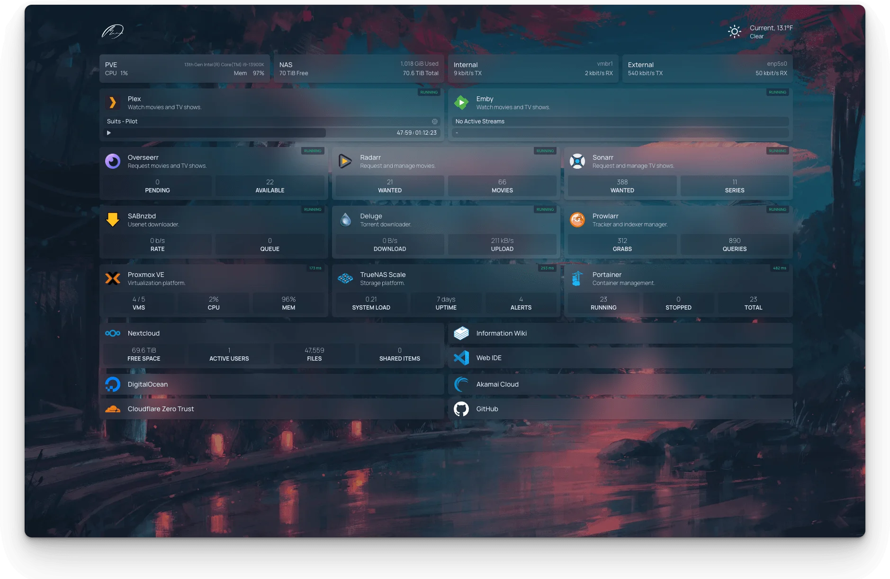

#

A modern, <em>fast</em>, secure <em>fully proxied</em>, highly customizable application dashboard with integrations for over 100 services and translations into multiple languages. Easily configured via YAML files or through docker label discovery.

<a href="https://foyer.arpanrec.com">Foyer</a> is a TypeScript fork of <a href="https://gethomepage.dev">Homepage</a>.

