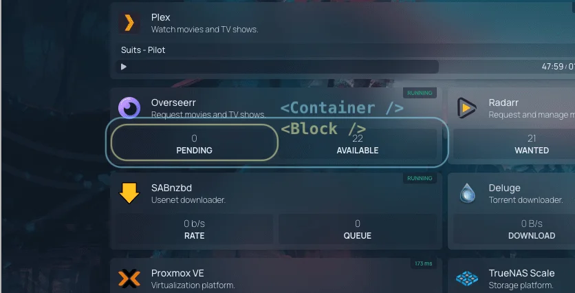

Foyer widgets are built using React components. These components are responsible for fetching data from the API and rendering the widget UI. Foyer provides a set of hooks and utilities to help you build your widget component.

## A Basic Widget Component

Here is an example of a basic widget component:

```tsx
import { useTranslation } from "next-i18next/pages";

import Block from "@/components/services/widget/block";
import Container from "@/components/services/widget/container";
import type { WidgetProps } from "@/types/service";
import useWidgetAPI from "@/utils/proxy/use-widget-api";
import type { YourWidgetInfo } from "@/widgets/yourwidget/types";

export default function Component({ service }: WidgetProps) {
    const { t } = useTranslation();
    const { widget } = service;
    const { data, error } = useWidgetAPI<YourWidgetInfo>(widget, "info");

    if (error) {
        return <Container service={service} error={error} />;
    }

    if (!data) {
        return (
            <Container service={service}>
                <Block label="yourwidget.key1" />
                <Block label="yourwidget.key2" />
                <Block label="yourwidget.key3" />
            </Container>
        );
    }

    return (
        <Container service={service}>
            <Block label="yourwidget.key1" value={t("common.number", { value: data.key1 })} />
            <Block label="yourwidget.key2" value={t("common.number", { value: data.key2 })} />
            <Block label="yourwidget.key3" value={t("common.number", { value: data.key3 })} />
        </Container>
    );
}
```

### Breakdown

We'll cover two sections of the widget component: hooks and components.

#### Hooks

**`useTranslation`**

This hook is used to translate text and numerical content in widgets. Foyer provides a set of helpers to help you localize your widgets. You can learn more about translations in the [Translations Guide](translations.md).

**`useWidgetAPI`**

This hook is used to fetch data from the API. The type argument (`YourWidgetInfo` above) describes the response body and is declared in the widget's `types.ts`. We cover this hook in more detail in the [API Guide](api.md).

#### Props

`WidgetProps` types the `service` prop. A widget that reads its own options from `service.widget` passes an options type, for example `WidgetProps<YourWidgetOptions>`. Every property of an options type is optional, because users can leave any of them out.

The browser only receives the widget options that `cleanServiceGroups` in `src/utils/config/service-helpers.ts` copies. Add each option your component reads to that whitelist: put the key in the destructuring list under a `// yourwidget` comment, and copy it onto `widget` in an `if (type === "yourwidget")` block further down. Never add credentials such as `key`, `username` or `password`. Options that only the proxy handler reads need no entry, because the server loads the full configuration itself.

#### Components

Foyer provides a set of components to help you build your widget UI. These components are designed to provide a consistent layout, and all widgets are expected to use these components.



**`<Container>`**

This component is a wrapper for the widget. It provides a consistent layout for all widgets.

```tsx
<Container service={service}></Container>
```

`service` is a prop that is passed to the widget component. It contains information about the service that the widget is displaying.

If there is an error fetching data from the API, the `error` prop can be passed to the `Container` component. It also takes a translated message, for example when a required option is missing. Nothing is shown when the user set `hideErrors`.

```tsx
<Container service={service} error={error}></Container>
```

`Container` also applies the user's `fields` option: it renders only the blocks whose `field` (or, without one, `label`) matches a configured field. A field without a dot is prefixed with the widget type, so `fields: ["key1"]` matches `yourwidget.key1`.

When the API offers more than four values, list the defaults and wrap the service with `withWidgetFields`, which applies them when the user sets no `fields` and caps the list at four:

```tsx
import withWidgetFields from "@/utils/widget-fields";

const DEFAULT_FIELDS = ["key1", "key2", "key3", "key4"];

export default function Component({ service: configuredService }: WidgetProps) {
    const service = withWidgetFields(configuredService, DEFAULT_FIELDS);
    // ...
}
```

**`<Block>`**

This component is used to display a key-value pair. It takes a label and value as props.

```tsx
<Block label="yourwidget.key1" value={t("common.number", { value: data.key1 })} />
```

The `label` prop is used to look up the translation key in the translation files. The `value` prop is used to display the value of the block. To learn more about translations, please refer to the [Translations Guide](translations.md).

If there is no data available, the `Block` component can be used to display a placeholder layout. A block without a `value` renders as a loading skeleton, so render the same blocks, in the same order, while loading and after.

```tsx
<Container service={service}>
    <Block label="yourwidget.key1" />
    <Block label="yourwidget.key2" />
    <Block label="yourwidget.key3" />
</Container>
```

Two more props:

- `field` names the block for the `fields` option when the label comes from another namespace. `<Block label="docker.running" field="yourwidget.running" />` reuses the existing "Running" string and still answers to `fields: ["running"]`.
- `highlightValue` gives the user's highlight rules the raw number when `value` is a formatted string, for example `highlightValue={latencyMs}`.
