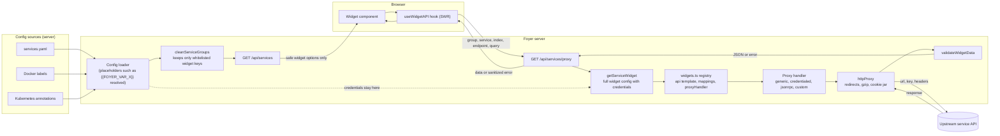
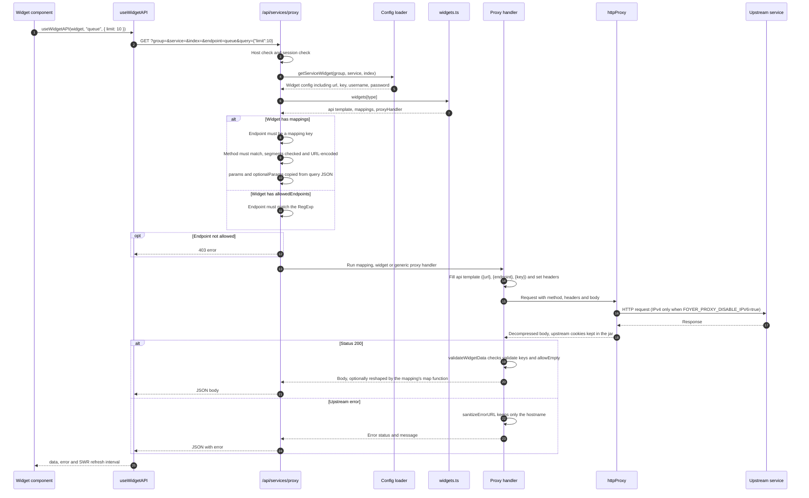

Foyer includes a set of built-in proxy handlers that can be used to fetch data from an API. We will go over how to use these proxy handlers and briefly cover how to create your own.

## How Proxying Works

The browser never receives service credentials. It sends only the service group, the service name, the widget index and an endpoint name. The server looks up the full widget configuration, builds the upstream request, and returns the response.

### Overview



### Request lifecycle



### What happens at each stage

| Stage             | Where it runs     | What it does                                                                                                                                   |
| ----------------- | ----------------- | ---------------------------------------------------------------------------------------------------------------------------------------------- |
| Config load       | Server            | Reads `services.yaml`, Docker labels and Kubernetes annotations, and substitutes `{{FOYER_VAR_*}}` and `{{FOYER_FILE_*}}` placeholders.        |
| Service list      | Server to browser | `/api/services` returns services after `cleanServiceGroups`, which drops every widget key that is not whitelisted, so credentials never leave. |
| Hook              | Browser           | `useWidgetAPI` builds the `/api/services/proxy` URL and SWR fetches it on the widget's refresh interval.                                       |
| Credential lookup | Server            | `getServiceWidget` reloads the full widget config, including credentials, by group, service name and index.                                    |
| Endpoint checks   | Server            | `mappings` or `allowedEndpoints` decide whether the endpoint is permitted. Anything else gets a 403.                                           |
| Proxy handler     | Server            | Fills the `api` template, adds authentication, and calls `httpProxy`.                                                                          |
| Validation        | Server            | `validateWidgetData` rejects bodies that lack the mapping's `validate` keys. Error URLs are reduced to their hostname.                         |

## Available Proxy Handlers

Foyer comes with a few built-in proxy handlers that can be used to fetch data from an API. These handlers are located in the `utils/proxy/handlers` directory.

### `genericProxyHandler`

A proxy handler that makes requests to the specified API endpoint without authentication, or with HTTP Basic authentication when the widget configuration has a `username` and `password`. It also sends the widget's `headers`, `method` and `requestBody` options.

```ts
import genericProxyHandler from "@/utils/proxy/handlers/generic";

const widgetExample = {
    api: "{url}/api/{endpoint}",
    proxyHandler: genericProxyHandler,
};
```

You can also pass API keys from the widget configuration to the proxy handler, for authenticated requests.

=== "widget.ts"

    ```ts
    import genericProxyHandler from "@/utils/proxy/handlers/generic";

    const widgetExample = {
      api: "{url}/api/{endpoint}?key={key}",
      proxyHandler: genericProxyHandler,
    };
    ```

=== "services.yaml"

    ```yaml
    # Widget Configuration
    - Your Widget:
        icon: yourwidget.svg
        href: https://example.com/
        widget:
          type: yourwidget
          url: http://example.com
          key: your-api-key
    ```

### `credentialedProxyHandler`

A proxy handler that makes authenticated requests by setting request headers. Credentials are pulled from the widgets configuration.

By default the key is passed as an `X-API-Key` header. Other schemes, such as `Authorization: Bearer <key>`, are chosen by widget type in `src/utils/proxy/handlers/credentialed.ts`. If your API expects one of them, add your widget type to the matching list there and cover it in `credentialed.test.ts`. For a scheme the handler does not have, add a case or create a new proxy handler. This handler sends no request body.

=== "widget.ts"

    ```ts
    import credentialedProxyHandler from "@/utils/proxy/handlers/credentialed";

    const widgetExample = {
      api: "{url}/api/{endpoint}?key={key}",
      proxyHandler: credentialedProxyHandler,
    };
    ```

=== "services.yaml"

    ```yaml
    - Your Widget:
        icon: yourwidget.svg
        href: https://example.com/
        widget:
          type: yourwidget
          url: http://127.0.0.1:1337
          key: your-api-key
    ```

### `jsonrpcProxyHandler`

A proxy handler that makes authenticated JSON-RPC requests to the specified API endpoint, either using username + password or an API token.
The endpoint is the method to call and queryParams are used as the parameters.

=== "component.tsx"

    ```tsx
    import type { WidgetProps } from "@/types/service";
    import useWidgetAPI from "@/utils/proxy/use-widget-api";
    import type { TriggerResponse } from "@/widgets/yourwidget/types";

    export default function Component({ service }: WidgetProps) {
      const { widget } = service;

      const { data, error } = useWidgetAPI<TriggerResponse>(widget, "trigger", {
        triggerids: "14062",
        output: "extend",
        selectFunctions: "extend",
      });
    }
    ```

=== "widget.ts"

    ```ts
    import type { WidgetDefinition } from "@/types/widget-definition";
    import jsonrpcProxyHandler from "@/utils/proxy/handlers/jsonrpc";

    const widgetExample = {
      api: "{url}/api/jsonrpc",
      proxyHandler: jsonrpcProxyHandler,

      mappings: {
        total: { endpoint: "total" },
        average: { endpoint: "average" },
        trigger: { endpoint: "trigger.get" },
      },
    } satisfies WidgetDefinition;
    ```

=== "services.yaml"

    ```yaml
    - Your Widget:
        icon: yourwidget.svg
        href: https://example.com/
        widget:
          type: yourwidget
          url: http://127.0.0.1:1337
          username: your-username
          password: your-password
    ```

    ```yaml
    - Your Widget:
        icon: yourwidget.svg
        href: https://example.com/
        widget:
          type: yourwidget
          url: http://127.0.0.1:1337
          key: your-api-token
    ```

### `synologyProxyHandler`

A proxy handler that makes authenticated requests to the specified Synology API endpoint. This is used exclusively for Synology DSM services.

=== "widget.ts"

    ```ts
    import synologyProxyHandler from "@/utils/proxy/handlers/synology";

    const widgetExample = {
      api: "{url}/webapi/{cgiPath}?api={apiName}&version={maxVersion}&method={apiMethod}",
      proxyHandler: synologyProxyHandler,

      mappings: {
        system_storage: {
          apiName: "SYNO.Core.System",
          apiMethod: 'info&type="storage"',
          endpoint: "system_storage",
        }
      },
    };
    ```

=== "services.yaml"

    ```yaml
    - Your Widget:
        icon: yourwidget.svg
        href: https://example.com/
        widget:
          type: yourwidget
          url: http://127.0.0.1:1337
          username: your-username
          password: your-password
    ```

## Creating a Custom Proxy Handler

You can create your own proxy handler to fetch data from an API. A proxy handler is an async function in `src/widgets/<widget>/proxy.ts`, set as the `proxyHandler` of the widget's metadata.

The proxy handler function takes three arguments:

- `req`: The request object. `req.query` holds the `group`, `service`, `index` and `endpoint` the component asked for.
- `res`: The response object.
- `map`: A function that maps the API response to the widget data. It is only set when the endpoint's mapping defines one.

The browser never sends the widget's credentials or URL. The handler loads them with `getServiceWidget(group, service, index)`, builds the upstream URL from the widget's `api` template, and answers with `res`.

Here is an example of a simple proxy handler that fetches data from an API and passes it to the widget:

```ts
import type { ApiRequest, ApiResponse } from "@/types/api";
import type { WidgetMapFn } from "@/types/widget-definition";
import getServiceWidget from "@/utils/config/service-helpers";
import createLogger from "@/utils/logger";
import { asJson, formatApiCall, sanitizeErrorURL } from "@/utils/proxy/api-helpers";
import { httpProxy } from "@/utils/proxy/http";
import widgets from "@/widgets/widgets";

const logger = createLogger("customProxyHandler");

export default async function customProxyHandler(req: ApiRequest, res: ApiResponse, map?: WidgetMapFn) {
    const { group, service, endpoint, index } = req.query;

    if (typeof group !== "string" || typeof service !== "string") {
        return res.status(400).json({ error: "Invalid proxy service type" });
    }

    const widget = await getServiceWidget(group, service, index);
    if (!widget || !widgets[widget.type]?.api) {
        return res.status(403).json({ error: "Service does not support API calls" });
    }

    const url = formatApiCall(widgets[widget.type].api, { endpoint, ...widget });
    const [status, , data, headers] = await httpProxy(url);

    if (status !== 200) {
        logger.debug("HTTP %d from %s", status, sanitizeErrorURL(url));
        return res
            .status(status)
            .json({ error: { message: "HTTP Error", url: sanitizeErrorURL(url), data: asJson(data) } });
    }

    return res.status(200).json(map ? map(data, headers) : asJson(data));
}
```

Proxy handlers are a complex topic and require a good understanding of TypeScript and the Foyer codebase. If you are new to Foyer, we recommend using the built-in proxy handlers. `src/widgets/npm/proxy.ts` is a complete example that logs in and caches a token.

## Testing proxy handlers

Proxy handlers are a common source of regressions because they deal with authentication, request formatting, and sometimes odd upstream API behavior.

When you add a new proxy handler or custom widget proxy, include tests that focus on behavior:

- **Request construction:** the correct URL/path, query params, headers, and auth (and that secrets are not accidentally logged).
- **Response mapping:** the payload shape expected by the widget/component (including optional/missing fields).
- **Error handling:** upstream non-200s, invalid JSON, timeouts, and unexpected payloads should produce a predictable result.

Test locations:

- Shared handlers live in `src/utils/proxy/handlers/*.ts` with tests alongside them (for example `src/utils/proxy/handlers/generic.test.ts`).
- Widget-specific proxies live in `src/widgets/<widget>/proxy.ts` with tests in `src/widgets/<widget>/proxy.test.ts`.
