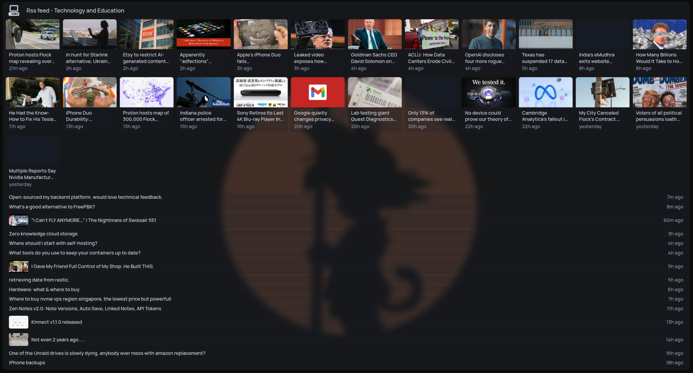
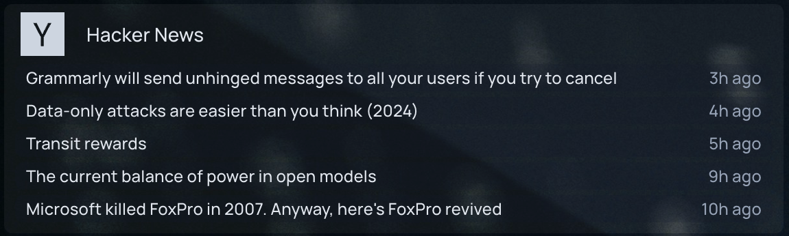
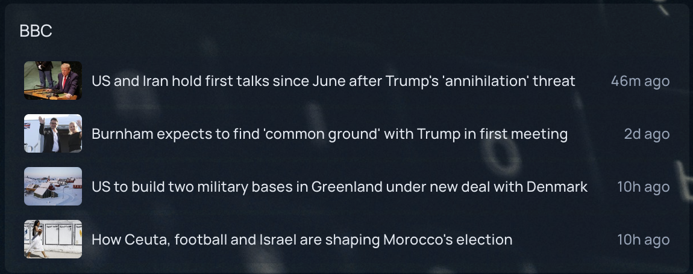
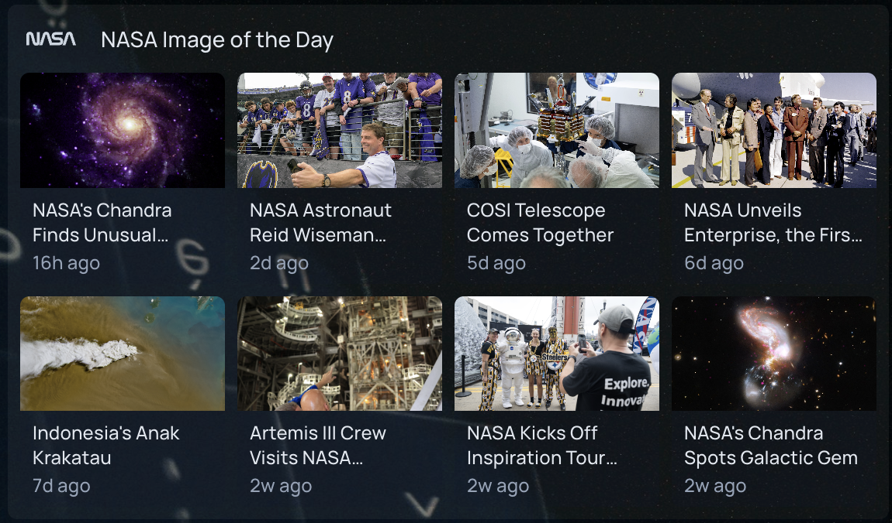

This widget shows the latest items from an RSS 2.0 or Atom feed.

```yaml
widget:
    type: feed
    url: https://feeds.bbci.co.uk/news/rss.xml
    maxItems: 5 # optional - defaults to 5
    layout: list # optional - possible values list, grid - defaults to list
    images: true # optional - set to false to hide images - defaults to true
    linkTo: item # optional - item or comments, see below - defaults to item
    disableYouTubeShorts: true # optional - filter out YouTube Shorts from YouTube feeds - defaults to true
    cache: 600000 # optional - milliseconds to keep each fetched feed, 0 to fetch on every refresh - defaults to 600000 (10 minutes)
```

## Multiple feeds

Use `urls` instead of `url` to show several feeds in one widget. Items from all the feeds are merged newest first, and `maxItems` applies to the merged list. `url` and `urls` can't be used together.

```yaml
- Software Development:
      widget:
          type: feed
          layout: grid
          maxItems: 12
          urls:
              - https://www.youtube.com/feeds/videos.xml?channel_id=UCsBjURrPoezykLs9EqgamOA
              - https://www.youtube.com/feeds/videos.xml?channel_id=UC8ENHE5xdFSwx71u3fDH5Xw
```

A group can hold several feed widgets, each with its own layout and list of feeds. Reddit subreddits and YouTube channels can be mixed in one widget:

```yaml
- Rss feed - Technology and Education:
      icon: mdi-desktop-classic
      widgets:
          - type: feed
            layout: grid
            maxItems: 25
            cache: 600000
            disableYouTubeShorts: true
            urls:
                - https://www.youtube.com/feeds/videos.xml?channel_id=UCXuqSBlHAE6Xw-yeJA0Tunw
                - https://www.youtube.com/feeds/videos.xml?channel_id=UCR-DXc1voovS8nhAvccRZhg
                - https://www.youtube.com/feeds/videos.xml?channel_id=UCBJycsmduvYEL83R_U4JriQ
                - https://www.youtube.com/feeds/videos.xml?channel_id=UCld68syR8Wi-GY_n4CaoJGA
                - https://www.reddit.com/r/technology/.rss
                - https://www.youtube.com/feeds/videos.xml?channel_id=UCWFKCr40YwOZQx8FHU_ZqqQ
                - https://www.youtube.com/feeds/videos.xml?channel_id=UCHnyfMqiRRG1u-2MsSQLbXA
          - type: feed
            layout: list
            maxItems: 15
            cache: 600000
            disableYouTubeShorts: true
            urls:
                - https://www.youtube.com/feeds/videos.xml?channel_id=UCwpHKudUkP5tNgmMdexB3ow
                - https://www.youtube.com/feeds/videos.xml?channel_id=UCClfFsWcT3N2I7VTXXyt84A
                - https://www.reddit.com/r/selfhosted/.rss
```



If some of the feeds fail to load, the widget shows items from the rest. It shows an error only when none of them load.

## Comment links

Aggregators such as Hacker News and Lobsters link each item to the article it points at, and put the discussion page in a separate `<comments>` tag. Set `linkTo: comments` to open the discussion page instead. Items that have no `<comments>` URL, such as posts from a regular blog in the same widget, keep their own link. Any value other than `item` or `comments` is an error.

```yaml
- Tech News:
      widget:
          type: feed
          linkTo: comments
          maxItems: 15
          urls:
              - https://news.ycombinator.com/rss
              - https://lobste.rs/rss
```

## Layouts

`list` shows one row per item. Items with an image get a small thumbnail.





`grid` shows image tiles that re-flow to fit the width of the widget, e.g.:

```yaml
- NASA Image of the Day:
      widget:
          type: feed
          url: https://www.nasa.gov/feeds/iotd-feed/
          layout: grid
          maxItems: 8
```



## Images

Images are taken from the feed's `media:thumbnail` / `media:content` tags or image enclosures, falling back to the first image in the item's content. Some feeds do not include images at all.

Images are loaded by your browser directly from the feed's host, at whatever size the feed provides. Feeds that link full-size originals can be slow to load; set `images: false` for those.

## YouTube Shorts

When a feed URL starts with `https://www.youtube.com/`, the widget filters out YouTube Shorts by default (`disableYouTubeShorts: true`). To include YouTube Shorts in the feed, set `disableYouTubeShorts: false`.

## Notes

Feeds are fetched by foyer, not your browser, and each feed is cached for `cache` milliseconds (600000, or 10 minutes, by default). The cache is kept per feed URL in the server's memory, so widgets that show the same feed share one entry, and restarting foyer clears it. Only successful fetches are cached. `cache` must be a number of milliseconds, 0 or more, and `0` turns the cache off. Any other value is an error.
