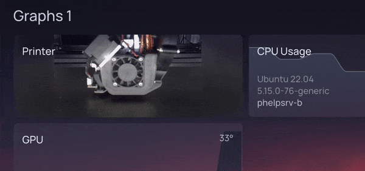

Pass the stream URL from a service like [µStreamer](https://github.com/pikvm/ustreamer) or [camera-streamer](https://github.com/ayufan/camera-streamer).

```yaml
widget:
    type: mjpeg
    stream: http://mjpeg.host.or.ip/webcam/stream
    fit: contain # optional, one of contain (default), cover, fill, none, scale-down
```
