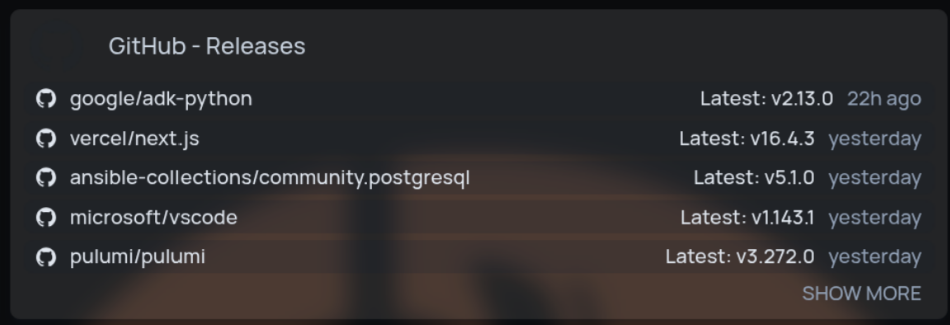

This widget lists the latest release of each repository you configure, newest first. Repositories can come from GitHub, GitLab or Forgejo (including Codeberg), on the public instances or your own.

```yaml
widget:
    type: releases
    repositories:
        - service: github
          repo: arpanrec/foyer
        - service: github
          repo: jellyfin/jellyfin
        - service: gitlab
          repo: fdroid/fdroidclient
        - service: forgejo
          repo: forgejo/forgejo
    servicesConfig: # optional
        github:
            token: github_pat_xxxxxxxx # optional - no auth by default
        gitlab:
            endpoint: https://gitlab.example.com/api/v4 # optional - defaults to https://gitlab.com/api/v4
            token: glpat-xxxxxxxx # optional - no auth by default
    showSourceIcon: true # optional - defaults to false
    includePrereleases: false # optional - include GitHub prereleases, defaults to false
    limit: 10 # optional - maximum number of releases to show, defaults to 10
    collapseAfter: 5 # optional - releases shown before "Show more", -1 to never collapse, defaults to 5
```



## Repositories

`repositories` is a list of entries, and each entry has exactly two keys:

- `service`: one of `github`, `gitlab` or `forgejo`.
- `repo`: the `owner/repo` name, not the full URL. GitLab also accepts nested groups such as `group/subgroup/project`.

The widget refuses to load and shows an error if `repositories` is missing or empty, if an entry has any other key, or if a `service` or `repo` value is invalid.

## Services config

`servicesConfig` is optional. Its keys are service names, and each one takes an optional `endpoint` and an optional `token`. Any other service name or key is an error.

| Service   | Default endpoint              | Token is sent as                |
| --------- | ----------------------------- | ------------------------------- |
| `github`  | `https://api.github.com`      | `Authorization: Bearer <token>` |
| `gitlab`  | `https://gitlab.com/api/v4`   | `PRIVATE-TOKEN: <token>`        |
| `forgejo` | `https://codeberg.org/api/v1` | `Authorization: token <token>`  |

`endpoint` is the API base URL of the instance. A self-hosted Forgejo instance uses `https://git.example.com/api/v1`, and GitHub Enterprise Server uses `https://github.example.com/api/v3`. Without a token, requests go out unauthenticated.

All repositories of a service in one widget share its endpoint and token. To track repositories from two instances of the same service, give each instance its own `releases` widget.

```yaml
- Self-hosted:
      widget:
          type: releases
          repositories:
              - service: forgejo
                repo: infra/ansible
          servicesConfig:
              forgejo:
                  endpoint: https://git.example.com/api/v1
                  token: "{{FOYER_VAR_FORGEJO_TOKEN}}"
```

## Tokens

GitHub allows 60 unauthenticated API requests per hour. If you track many repositories, create a [read-only fine-grained token](https://github.com/settings/personal-access-tokens/new) and set it as `servicesConfig.github.token`. Private GitLab projects and private Forgejo repositories also need a token with read access.

Like other widget secrets, tokens can be supplied through `FOYER_VAR_` or `FOYER_FILE_` substitution so they stay out of `services.yaml`.

## Prereleases

Set `includePrereleases: true` to show the newest GitHub release even when it is a prerelease. The setting covers every GitHub repository in the widget and has no effect on GitLab or Forgejo. To track prereleases for only some repositories, give those their own service:

```yaml
- Emby:
      widget:
          type: releases
          includePrereleases: true
          repositories:
              - service: github
                repo: MediaBrowser/Emby.Releases
```

## Notes

Releases are fetched by foyer, not your browser. Each release is cached for 2 hours. If some repositories fail to load, the widget shows the rest along with a count of the failures, and the reason is written to the foyer logs.

GitHub releases with more than 3 thumbs-down reactions show the count next to a ⚠ sign.
